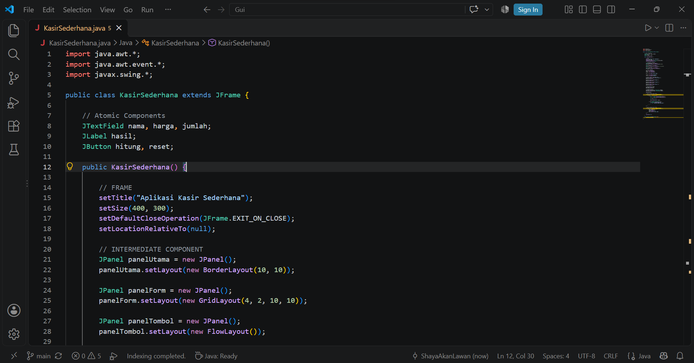

# Aplikasi Kasir Sederhana – Materi GUI Java

Repository ini berisi contoh GUI (*Graphical User Interface*) sederhana menggunakan **Java Swing**. Programnya berupa aplikasi kasir mini: pengguna bisa memasukkan nama barang, harga, dan jumlah barang, lalu menekan tombol **Hitung** untuk melihat total harga. Tombol **Reset** digunakan untuk mengosongkan kembali isian.

## Tampilan program di Visual Studio Code

Berikut foto kode `KasirSederhana.java` yang menjadi dasar pembahasan README ini.



## 1. Apa itu GUI?

GUI (*Graphical User Interface*) adalah antarmuka yang memungkinkan pengguna berinteraksi dengan program melalui elemen visual, seperti jendela, tombol, kolom input, dan teks. Jadi, pengguna tidak harus selalu mengetik perintah melalui terminal.

Pada program ini, pengguna berinteraksi melalui jendela aplikasi kasir, mengisi kolom harga dan jumlah, kemudian menekan tombol untuk menjalankan perhitungan.

## 2. Library yang digunakan

Di bagian awal kode terdapat tiga import:

```java
import java.awt.*;
import java.awt.event.*;
import javax.swing.*;
```

Penjelasannya:

- `java.awt.*` menyediakan komponen dan pengaturan tampilan, termasuk layout seperti `BorderLayout`, `GridLayout`, dan `FlowLayout`.
- `java.awt.event.*` menyediakan kebutuhan untuk menangani kejadian (*event*), misalnya saat tombol diklik.
- `javax.swing.*` menyediakan komponen GUI Swing, seperti `JFrame`, `JPanel`, `JLabel`, `JTextField`, `JButton`, dan `JOptionPane`.

## 3. Struktur utama program

```java
public class KasirSederhana extends JFrame {
    // isi program
}
```

`KasirSederhana` adalah nama kelas utama. Kelas ini menggunakan `extends JFrame`, artinya kelas tersebut mewarisi fungsi dari `JFrame` dan bisa bertindak sebagai sebuah jendela aplikasi.

Di dalam kelas, komponen dideklarasikan terlebih dahulu:

```java
JTextField nama, harga, jumlah;
JLabel hasil;
JButton hitung, reset;
```

- `JTextField nama`: kolom untuk memasukkan nama barang.
- `JTextField harga`: kolom untuk memasukkan harga barang.
- `JTextField jumlah`: kolom untuk memasukkan jumlah barang.
- `JLabel hasil`: bagian untuk menampilkan total harga.
- `JButton hitung`: tombol untuk menghitung total.
- `JButton reset`: tombol untuk mengosongkan isian.

## 4. Tiga jenis komponen GUI dalam program

Dalam materi GUI, komponen pada program ini bisa dikelompokkan menjadi *frame*, *intermediate component*, dan *atomic component*.

### A. Frame

*Frame* adalah jendela utama yang menjadi tempat seluruh komponen aplikasi ditampilkan. Pada program ini, frame berasal dari `JFrame` karena kelas `KasirSederhana` mewarisi `JFrame`.

Pengaturannya dilakukan di constructor:

```java
setTitle("Aplikasi Kasir Sederhana");
setSize(400, 300);
setDefaultCloseOperation(JFrame.EXIT_ON_CLOSE);
setLocationRelativeTo(null);
```

Arti setiap perintah:

- `setTitle(...)` memberi judul pada bagian atas jendela.
- `setSize(400, 300)` mengatur ukuran jendela menjadi lebar 400 dan tinggi 300 piksel.
- `setDefaultCloseOperation(JFrame.EXIT_ON_CLOSE)` membuat aplikasi berhenti ketika jendela ditutup.
- `setLocationRelativeTo(null)` menempatkan jendela di tengah layar.

### B. Intermediate component

*Intermediate component* merupakan komponen penampung yang digunakan untuk mengelompokkan atau mengatur komponen lain. Di program ini, komponen tersebut adalah `JPanel`.

```java
JPanel panelUtama = new JPanel();
panelUtama.setLayout(new BorderLayout(10, 10));

JPanel panelForm = new JPanel();
panelForm.setLayout(new GridLayout(4, 2, 10, 10));

JPanel panelTombol = new JPanel();
panelTombol.setLayout(new FlowLayout());
```

Ada tiga panel dengan tugas berbeda:

1. `panelUtama` menjadi penampung utama. Layout `BorderLayout` membagi area menjadi beberapa posisi, dan program menggunakan bagian `CENTER` serta `SOUTH`.
2. `panelForm` menampung label, kolom input, dan label hasil. Layout `GridLayout(4, 2, 10, 10)` membuat susunan 4 baris dan 2 kolom, dengan jarak horizontal dan vertikal 10 piksel.
3. `panelTombol` menampung tombol Hitung dan Reset. Layout `FlowLayout` menyusun komponen secara berurutan dalam satu baris selama ruangnya cukup.

Setelah komponen dibuat, panel-panel tersebut disusun seperti berikut:

```java
panelUtama.add(panelForm, BorderLayout.CENTER);
panelUtama.add(panelTombol, BorderLayout.SOUTH);
add(panelUtama);
```

Artinya, form ditempatkan di bagian tengah, tombol ditempatkan di bagian bawah, lalu `panelUtama` dimasukkan ke frame utama.

### C. Atomic component

*Atomic component* adalah komponen antarmuka yang digunakan langsung oleh pengguna atau untuk menampilkan informasi. Contohnya adalah kolom input, label, dan tombol.

```java
nama = new JTextField();
harga = new JTextField();
jumlah = new JTextField();

hasil = new JLabel("Total: Rp0");

hitung = new JButton("Hitung");
reset = new JButton("Reset");
```

- `JTextField` menerima teks yang diketik pengguna.
- `JLabel` menampilkan teks atau informasi. Pada aplikasi ini, label `hasil` menampilkan total harga.
- `JButton` menyediakan tombol yang bisa diklik untuk menjalankan tindakan.

Komponen kemudian dimasukkan ke `panelForm` dan `panelTombol`:

```java
panelForm.add(new JLabel("Nama Barang:"));
panelForm.add(nama);
panelForm.add(new JLabel("Harga:"));
panelForm.add(harga);
panelForm.add(new JLabel("Jumlah:"));
panelForm.add(jumlah);
panelForm.add(new JLabel("Hasil:"));
panelForm.add(hasil);

panelTombol.add(hitung);
panelTombol.add(reset);
```

Urutan penambahan komponen mengikuti susunan sel pada `GridLayout`, yaitu dari kiri ke kanan lalu ke baris berikutnya.

## 5. Layout manager yang digunakan

*Layout manager* mengatur posisi dan ukuran komponen di dalam sebuah container. Program ini menggunakan tiga layout:

| Layout | Digunakan pada | Fungsi |
|---|---|---|
| `BorderLayout(10, 10)` | `panelUtama` | Mengatur komponen berdasarkan area seperti `CENTER` dan `SOUTH`, dengan jarak 10 piksel. |
| `GridLayout(4, 2, 10, 10)` | `panelForm` | Menyusun komponen dalam 4 baris dan 2 kolom dengan jarak 10 piksel. |
| `FlowLayout()` | `panelTombol` | Menyusun tombol secara berurutan. |

Dengan pembagian ini, form dan tombol tidak perlu diatur satu per satu menggunakan koordinat secara manual.

## 6. Event listener

*Event listener* adalah mekanisme yang membuat program bisa merespons tindakan pengguna. Pada aplikasi ini, event yang digunakan adalah klik tombol. Kode `addActionListener(...)` memasang pendengar kejadian pada tombol.

### A. Event listener tombol Hitung

```java
hitung.addActionListener(new ActionListener() {
    public void actionPerformed(ActionEvent e) {
        try {
            int h = Integer.parseInt(harga.getText());
            int j = Integer.parseInt(jumlah.getText());

            int total = h * j;
            hasil.setText("Rp" + total);

        } catch (NumberFormatException ex) {
            JOptionPane.showMessageDialog(
                null, "Masukkan angka yang benar!"
            );
        }
    }
});
```

Alur kerjanya:

1. Pengguna mengklik tombol **Hitung**.
2. `actionPerformed(...)` dijalankan sebagai respons terhadap klik tersebut.
3. `harga.getText()` mengambil isi kolom harga, sedangkan `jumlah.getText()` mengambil isi kolom jumlah.
4. `Integer.parseInt(...)` mengubah teks menjadi bilangan bulat agar bisa dihitung.
5. Program mengalikan harga dengan jumlah: `total = h * j`.
6. `hasil.setText(...)` memperbarui label hasil agar total terlihat di jendela.
7. Jika harga atau jumlah bukan bilangan bulat yang valid, proses konversi dapat menghasilkan `NumberFormatException`. Bagian `catch` lalu menampilkan pesan melalui `JOptionPane`.

Contoh: jika harga diisi `5000` dan jumlah diisi `3`, hasil perhitungannya adalah `Rp15000`.

**Catatan:** kolom nama barang sudah tersedia di tampilan, tetapi pada kode saat ini nilainya belum digunakan dalam proses perhitungan.

### B. Event listener tombol Reset

```java
reset.addActionListener(new ActionListener() {
    public void actionPerformed(ActionEvent e) {
        nama.setText("");
        harga.setText("");
        jumlah.setText("");
        hasil.setText("Total: Rp0");
    }
});
```

Ketika tombol **Reset** diklik, program mengosongkan kolom nama, harga, dan jumlah. Label hasil juga dikembalikan ke tulisan `Total: Rp0`.

## 7. Menampilkan aplikasi

Di akhir constructor terdapat:

```java
setVisible(true);
```

Perintah ini membuat jendela aplikasi terlihat. Tanpa perintah tersebut, frame sudah dibuat dan komponennya sudah disusun, tetapi jendelanya belum ditampilkan.

Kemudian terdapat method `main`:

```java
public static void main(String[] args) {
    new KasirSederhana();
}
```

`main` merupakan titik awal program Java. Saat program dijalankan, baris `new KasirSederhana()` membuat objek dari kelas tersebut. Constructor `KasirSederhana()` lalu berjalan untuk mengatur frame, membuat komponen, memasang event listener, dan menampilkan jendela.

## 8. Cara menjalankan program

1. Pastikan Java JDK sudah terpasang.
2. Simpan kode dengan nama file `KasirSederhana.java` karena nama file harus sama dengan nama kelas `public`.
3. Buka terminal pada folder tempat file disimpan.
4. Compile program:

   ```bash
   javac KasirSederhana.java
   ```

5. Jalankan program:

   ```bash
   java KasirSederhana
   ```

6. Isi nama barang, harga, dan jumlah. Klik **Hitung** untuk melihat total atau **Reset** untuk mengosongkan form.

## 9. Ringkasan alur program

Secara sederhana, urutan kerja aplikasi adalah:

1. Program dimulai dari method `main`.
2. Objek `KasirSederhana` dibuat dan constructor dijalankan.
3. Frame diatur ukuran, judul, posisi, dan perilaku saat ditutup.
4. `JPanel` dibuat sebagai intermediate component dan diberi layout.
5. Atomic component seperti `JTextField`, `JLabel`, dan `JButton` dibuat lalu dimasukkan ke panel.
6. Event listener dipasang pada tombol Hitung dan Reset.
7. `setVisible(true)` menampilkan jendela.
8. Saat tombol diklik, event listener menjalankan tindakan yang sesuai.

## 10. Kesimpulan

Program `KasirSederhana` merupakan contoh GUI dasar menggunakan Java Swing. Dari program ini, kita bisa melihat hubungan antara frame sebagai jendela utama, intermediate component sebagai penampung, atomic component sebagai elemen yang digunakan pengguna, layout manager untuk mengatur susunan tampilan, dan event listener untuk membuat tombol bisa menjalankan perintah.

Intinya, GUI bukan hanya soal membuat tampilan aplikasi, tetapi juga menghubungkan komponen visual dengan proses yang berjalan di dalam program. Pada contoh ini, hubungan tersebut terlihat saat pengguna memasukkan harga dan jumlah, menekan tombol Hitung, lalu aplikasi menampilkan total belanja.
